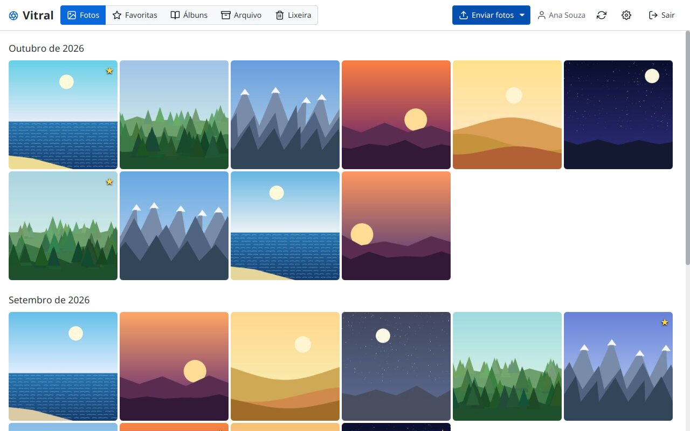
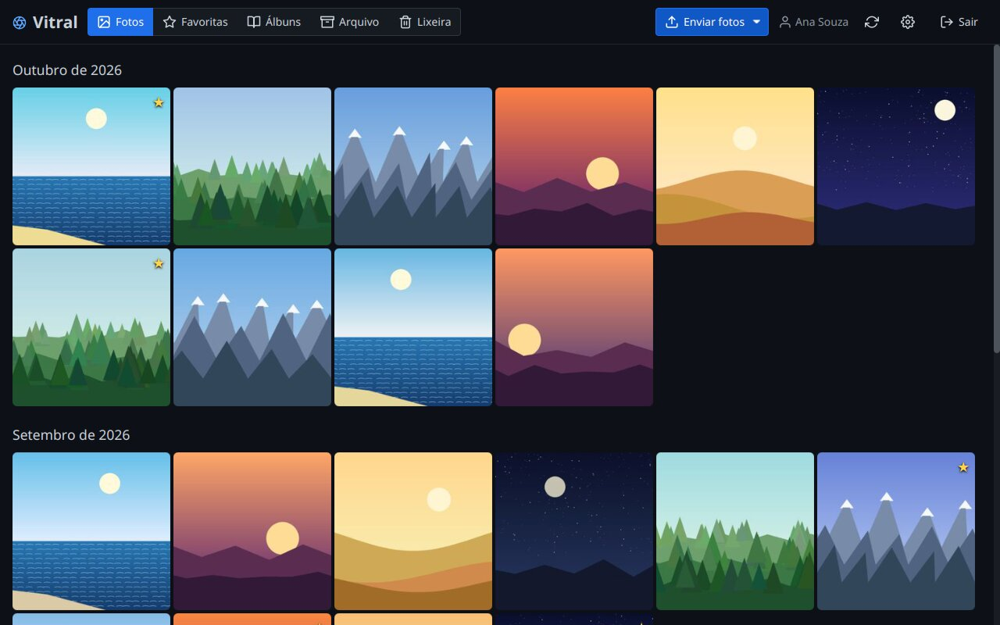
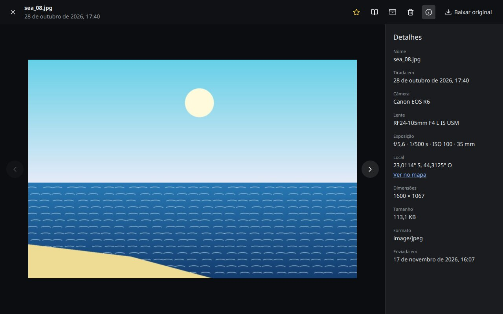
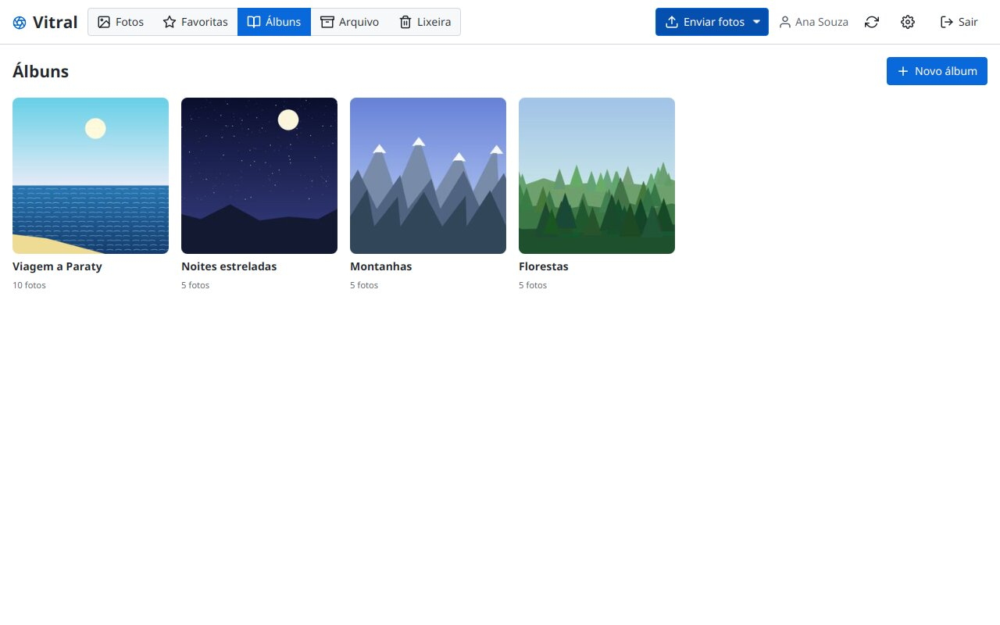
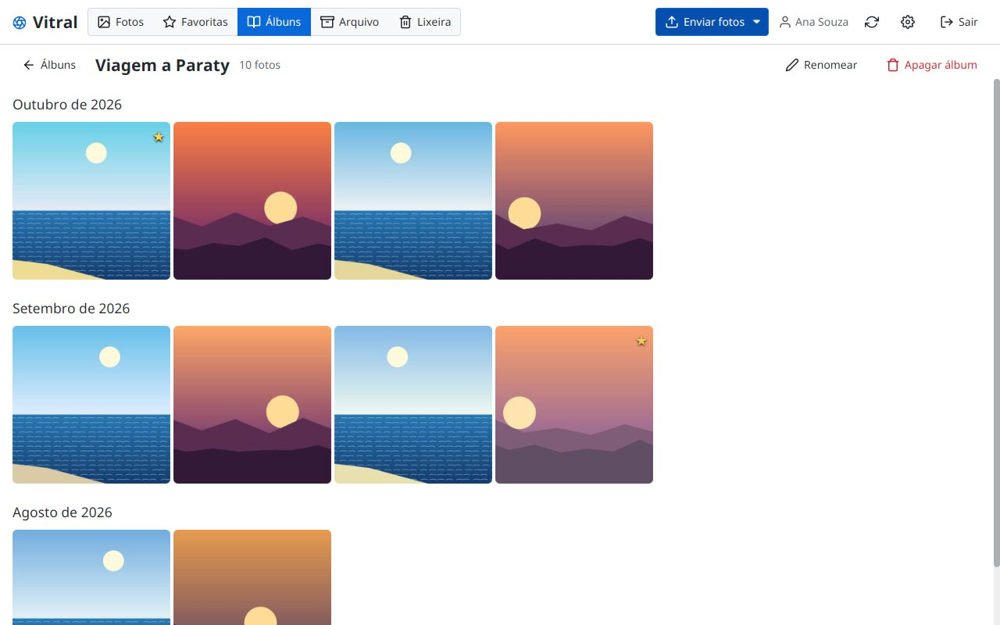
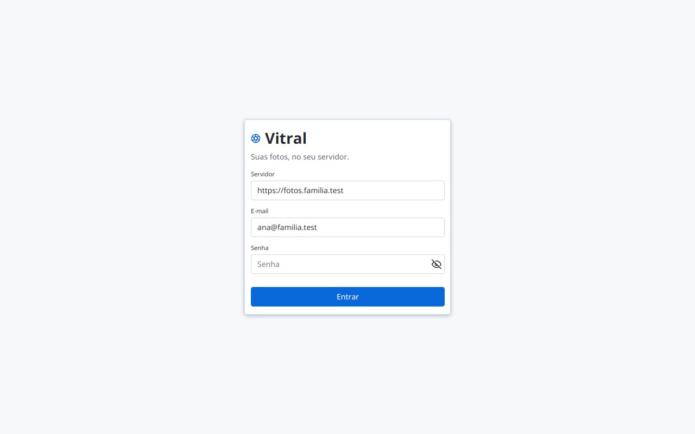
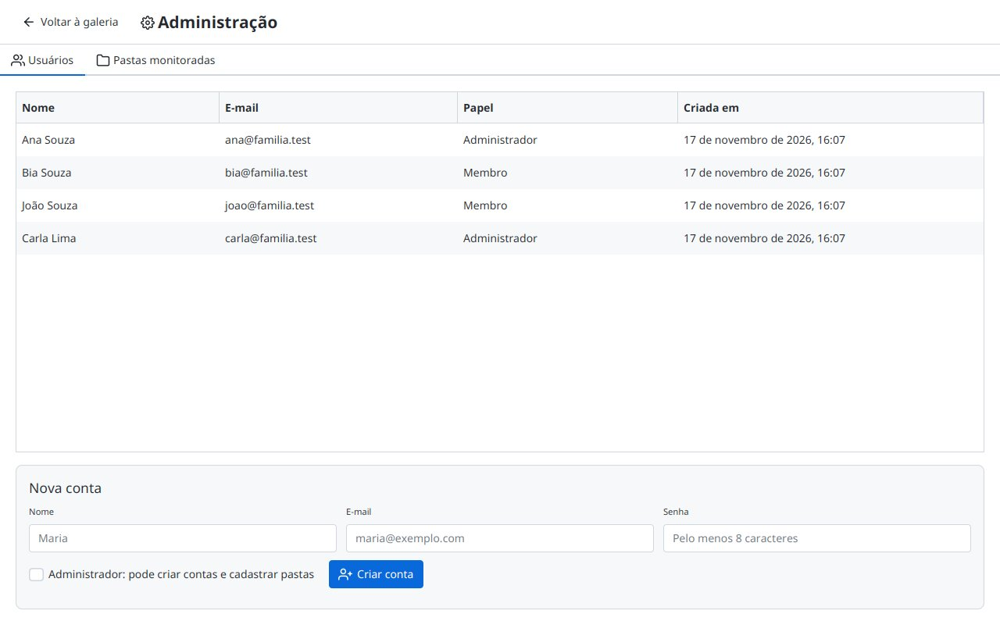

<div align="center">

# Vitral

**Suas fotos, no seu servidor.**

Um gerenciador de fotos self-hosted e totalmente open source: uma alternativa ao Google Fotos
que roda num computador seu, sem entregar sua biblioteca a ninguém.

[](https://github.com/metalicarus/vitral/actions/workflows/ci.yml)


-lightgrey)



</div>

> **Status:** em desenvolvimento. O servidor e o client desktop já cobrem o uso do dia a dia com fotos;
> ainda não há uma versão publicada para instalar (veja [o que vem depois](#o-que-vem-depois)).

## O que já dá para fazer

### Uma galeria rápida, mês a mês

As fotos aparecem da mais recente para a mais antiga, agrupadas por mês, e mais fotos carregam conforme
você rola. Os botões no topo trocam entre **Fotos**, **Favoritas**, **Álbuns**, **Arquivo** e **Lixeira**.
O tema claro ou escuro acompanha o do sistema.

<p align="center">
  
</p>

### Cada foto em tela cheia, com os detalhes

Um clique abre a foto do maior tamanho que a janela permite. A tecla **I** mostra câmera, lente,
exposição, o local onde ela foi tirada (com um link para o mapa), dimensões e tamanho. Dali mesmo dá para
favoritar, pôr num álbum, arquivar, mandar para a lixeira ou baixar o original.



### Álbuns

Junte fotos em álbuns, escolha a capa e navegue por cada um como uma galeria própria. Apagar um álbum
nunca apaga as fotos; uma foto na lixeira some dos álbuns e volta se for restaurada.

| Os álbuns, com suas capas | Um álbum aberto |
| --- | --- |
|  |  |

### Backup sem duplicar nada

- **Envio pelo client:** escolha fotos ou uma pasta inteira, ou arraste para a janela. O client pergunta ao
  servidor o que ele já tem (pelo SHA-256 de cada arquivo) e só envia o que falta.
- **Pastas monitoradas:** aponte o Vitral para a pasta que o Syncthing mantém sincronizada com o celular.
  As fotos novas aparecem em segundos, catalogadas onde estão: o Vitral só lê a pasta, nunca altera nem
  apaga nada nela.

### Para a família toda

Num servidor novo, a própria tela de login cria a conta de administrador. Depois, a área de
administração cria as contas da família e cadastra as pastas monitoradas, sem nenhum comando.

| Entrar no servidor | Administração |
| --- | --- |
|  |  |

## Princípios

- **Seus dados, seu servidor:** nenhuma chamada a serviços externos por padrão e nenhuma telemetria. O
  único link para fora é o "Ver no mapa", e só quando você clica.
- **Originais intocáveis:** o Vitral nunca altera um arquivo original.
- **Leve primeiro:** roda sem GPU e em hardware modesto, como um PC antigo, um NAS ou um Raspberry Pi.
- **Formatos abertos:** os originais ficam em pastas comuns, legíveis sem o Vitral.

## Partes do projeto

| Pasta | O que é | Tecnologia |
| --- | --- | --- |
| [`vitral-backend/`](vitral-backend/) | O servidor: guarda, cataloga e processa as fotos e expõe a API REST | Java 25, Quarkus, SQLite, libvips |
| [`vitral-client/`](vitral-client/) | O aplicativo desktop: galeria, visualizador, álbuns, envio e administração | Java 25, JavaFX, AtlantaFX |
| `vitral-frontend/` | Interface web, no navegador (planejada) | SvelteKit |

Mais adiante, um app mobile vai cuidar do backup automático do celular, usando a mesma API. Até lá, o
backup do celular funciona com o Syncthing e as pastas monitoradas.

## Começando

Com JDK 25 e Maven instalados (não é preciso Docker nem banco de dados), suba o servidor:

```bash
cd vitral-backend/server
mvn quarkus:dev
```

A API sobe em `http://localhost:8080`, com documentação interativa em `/q/swagger-ui`. Em outro terminal,
abra o client. Num servidor novo, a própria tela de login cria a conta de administrador:

```bash
cd vitral-client
mvn javafx:run
```

Os detalhes ficam nos READMEs de cada parte: o [do servidor](vitral-backend/README.md) traz a arquitetura,
a configuração, os logs, o Docker e a API; o [do client](vitral-client/README.md) descreve cada tela.

## O que vem depois

**Já feito:** contas e sessões, upload com deduplicação, miniaturas e prévias, metadados completos
(câmera, lente, exposição e GPS), pastas monitoradas, favoritos, arquivo e lixeira, álbuns, logs
detalhados no servidor, e o client desktop com tudo isso.

**Próximos passos:**
- Compartilhamento de álbuns entre as contas da família
- Nome da cidade a partir da posição GPS, com uma base offline
- Seleção de várias fotos de uma vez na galeria
- Interface web e app mobile com backup automático

**Deixado para depois, de propósito:**
- **Vídeos.** Processar vídeo (miniaturas, conversão para um formato que toque em qualquer lugar) exige o
  FFmpeg instalado no servidor, uma dependência grande, e o JavaFX ainda tem limitações para reproduzir
  alguns formatos. Por isso o foco, por enquanto, é fazer as fotos funcionarem muito bem; o client
  ignora vídeos ao enviar e o servidor os recusa. A decisão está registrada na
  [ADR 0005](vitral-backend/docs/adr/0005-videos-adiados.md).
- **Instaladores e versões publicadas:** imagem Docker pronta para baixar, instaladores do client para
  Linux, Windows e macOS e um guia para instalar num servidor remoto, com HTTPS. Vêm depois das features.

## Qualidade

A cada push na `main` e a cada pull request, o GitHub Actions roda os testes do servidor (com o libvips,
para os testes de miniatura não serem pulados), constrói a imagem Docker e roda os testes do client; o
resultado aparece no próprio PR. O [Dependabot](.github/dependabot.yml) propõe toda semana as versões de
correção das dependências, e cada proposta passa pelo CI.

As decisões de arquitetura ficam registradas como ADRs em [`vitral-backend/docs/adr/`](vitral-backend/docs/adr/).

As imagens das capturas de tela são paisagens desenhadas por um script, não fotos de verdade.

## Licença

[AGPL-3.0](LICENSE) (proposta).
