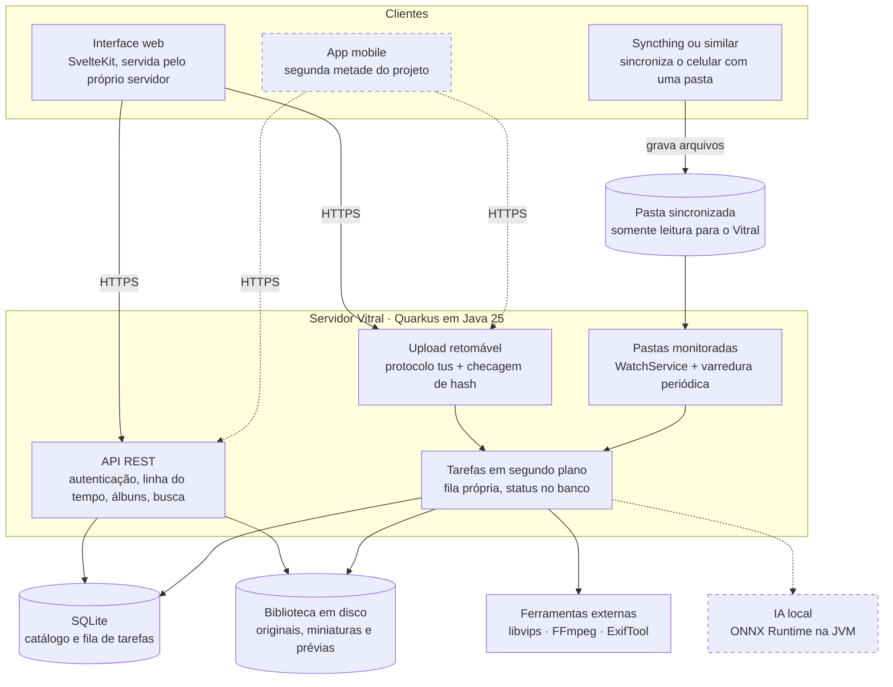
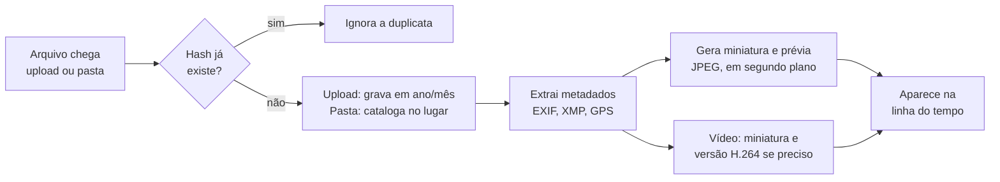

# Vitral · Servidor

Este é o servidor do [Vitral](../README.md). **Suas fotos, no seu servidor.** O Vitral é um gerenciador de fotos e vídeos self-hosted e totalmente open source: você instala em um servidor seu, envia suas fotos e navega por elas pelo navegador, sem entregar sua biblioteca a terceiros.

> **Status:** em desenvolvimento inicial (marco M0). Ainda não há versão utilizável.

## Princípios

- **Seus dados, seu servidor:** nenhuma chamada a serviços externos por padrão e nenhuma telemetria.
- **Originais intocáveis:** o Vitral nunca altera um arquivo original.
- **Leve primeiro:** roda sem GPU e em hardware modesto, como um PC antigo, um NAS ou um Raspberry Pi.
- **Formatos abertos:** os originais ficam em pastas comuns, legíveis sem o Vitral.

## Como o projeto está dividido

O Vitral é construído em duas metades:

1. **Servidor (foco atual):** armazena, cataloga e processa as fotos, e serve uma interface web para visualizá-las. É uma peça só: sobe o servidor, acessa o endereço, vê as fotos.
2. **App mobile (depois):** backup automático do celular e navegação no aparelho, usando a mesma API do servidor.

Enquanto o app não existe, o backup do celular pode ser feito com ferramentas de sincronização como o Syncthing, apontando para uma pasta que o Vitral monitora.

## Blueprint



Componentes tracejados são de fases futuras. Os clientes falam apenas com o servidor; banco, disco e ferramentas nunca ficam expostos à rede.

### Fluxo de ingestão

Todo arquivo, venha do upload ou de uma pasta monitorada, passa pela mesma sequência de tarefas. Cada etapa pode ser refeita sem reenviar o arquivo.



Arquivos de pastas monitoradas são catalogados no lugar: o Vitral só lê, nunca move nem apaga. Assim a sincronização com o celular continua funcionando normalmente.

### A impressão digital dos arquivos

O Vitral reconhece cada arquivo pelo seu SHA-256, um código de 64 caracteres calculado a partir do conteúdo. Ele funciona como uma impressão digital: depende só dos bytes do arquivo, e não do nome, da pasta ou da data. Por isso, o mesmo arquivo gera o mesmo código em qualquer lugar, seja no celular, no computador ou no servidor.

```bash
$ sha256sum IMG_1234.HEIC
9f86d081884c7d659a2feaa0c55ad015a3bf4f1b2b0b822cd15d6c15b0f00a08  IMG_1234.HEIC
```

Isso permite duas coisas:

- **Sem duplicatas:** ao receber um arquivo, o servidor calcula o código e, se o usuário já tem uma foto com o mesmo código, devolve a existente em vez de guardar uma cópia. Reenviar fotos, ou repetir um backup interrompido, nunca duplica nada.
- **Backup sem retransmitir:** um cliente calcula os códigos dos próprios arquivos, sem enviá-los, e pergunta ao `POST /api/v1/assets/check` quais o servidor ainda não tem. Num celular com 5.000 fotos em que 4.990 já foram salvas, só 10 arquivos trafegam.

O cliente nunca precisa receber os códigos do servidor: cada lado calcula os seus, e eles coincidem porque o conteúdo é o mesmo. O servidor também não confia no código informado pelo cliente; no upload, ele sempre recalcula a partir do que recebeu.

A contrapartida é que qualquer mudança nos bytes gera outro código. Uma foto editada, recortada ou convertida (por exemplo, de HEIC para JPEG ao ser exportada do celular) é um arquivo diferente para o Vitral, mesmo parecendo a mesma imagem. Reconhecer fotos *parecidas* é outro problema, previsto no roadmap como detecção de duplicatas e fotos parecidas.

## Stack

| Camada | Tecnologia |
| --- | --- |
| Linguagem | Java 25 (LTS) |
| Framework | Quarkus 3.33 LTS, em modo JVM (modo nativo como opção futura) |
| API | Quarkus REST (Jakarta REST) com documentação OpenAPI |
| Persistência | Hibernate ORM com Panache e migrações com Flyway |
| Banco de dados | SQLite em arquivo único, modo WAL |
| Senhas | Argon2id (Bouncy Castle), no formato PHC |
| Tarefas em segundo plano | Fila própria no servidor, com o status de cada tarefa no SQLite (ADR 0003) |
| Metadados | metadata-extractor, com ExifTool para casos difíceis |
| Imagens | libvips (com libheif para HEIC), chamado como processo externo |
| Vídeo | FFmpeg, chamado como processo externo *(adiado, veja a ADR 0005)* |
| Interface web | SvelteKit, em [`vitral-frontend/`](../README.md) (planejado) |
| Build | Maven |
| Implantação | Docker Compose, imagens para amd64 e arm64 |

## Estrutura do repositório

```
vitral-backend/
├── server/                    # Servidor Quarkus (Maven)
│   └── src/main/java/com/genosha/vitral/
│       ├── common/            # Erros da API
│       ├── config/            # Configurações (prefixo vitral.)
│       ├── system/            # Informações públicas do servidor
│       ├── user/              # Usuários e administração
│       │   └── auth/          # Login, sessões e setup inicial
│       ├── asset/             # Itens: fotos, vídeos e o upload
│       ├── ingest/            # Pastas monitoradas (depois: upload retomável e Google Takeout)
│       ├── media/             # Formatos, metadados e, no M1, miniaturas e vídeo
│       ├── storage/           # A biblioteca em disco
│       ├── timeline/          # (M2) Linha do tempo e busca
│       └── album/             # Álbuns (depois: compartilhamento)
├── docs/adr/                  # Registros de decisões de arquitetura
├── docker/                    # Dockerfile
├── docker-compose.yml
└── README.md
```

O código do servidor é organizado por funcionalidade, não por camada técnica: tudo o que diz respeito a álbuns, por exemplo, fica em `album/`. Pastas marcadas com (M1) ou (M2) chegam nesses marcos.

## Roadmap

A v1 do servidor reúne os itens até o M2, exceto os marcados com *(v1.1)*, que chegam logo depois dela.

**M0 · Fundação**
- [x] Repositório, CI e Docker Compose
- [ ] Licença (AGPL-3.0 proposta)
- [x] Esqueleto do servidor Quarkus com SQLite e Flyway
- [x] Contas, login e sessões
- [x] Minha conta (nome, senha e aparelhos conectados) e gestão das contas pelo administrador: senha, papel e desativação
- [x] Backup automático do banco, com cópias para baixar

**M1 · Ingestão**
- [x] Catálogo de fotos: upload, verificação de hashes, listagem, consulta e download do original
- [x] Miniaturas e prévias em JPEG, geradas em segundo plano
- [ ] Processamento de vídeo *(adiado de propósito: depende do FFmpeg; veja a [ADR 0005](docs/adr/0005-videos-adiados.md))*
- [x] Pastas monitoradas e importação de pastas existentes
- [x] Metadados: câmera, lente, exposição e posição GPS (fotos antigas são relidas sozinhas)
- [ ] Cidade a partir da posição GPS, com uma base offline *(v1.1)*
- [ ] Upload retomável com checagem de hash *(v1.1)*

**M2 · Interface web (fecha a primeira metade)**
- [ ] Linha do tempo e visualizador
- [x] Favoritos, arquivo e lixeira (fotos apagadas ficam 30 dias na lixeira)
- [x] Álbuns, com capa escolhida (fotos na lixeira ficam escondidas até serem restauradas)
- [ ] Compartilhamento por usuário e por link
- [ ] Mapa e busca por metadados *(v1.1)*
- [ ] Importação do Google Takeout *(v1.1)*

**M3 · App mobile (segunda metade)**
- [ ] Backup automático em segundo plano
- [ ] Navegação na biblioteca pelo celular

**Depois**
- [ ] IA local: rostos, pessoas e busca semântica
- [ ] Duplicatas, memórias e edição básica não destrutiva
- [ ] Live Photos, RAW, armazenamento S3 e login via OIDC
- [ ] Restauração do banco pela API, restrita a administradores (hoje ela é manual; veja [Backup do banco](#backup-do-banco))
- [ ] Pasta de dados padrão em `/var/lib/vitral` ao rodar fora do modo de desenvolvimento (o modo de desenvolvimento continua com `data/`)
- [ ] `VITRAL_LIBRARY_DIR` opcional, para guardar as fotos em outro disco, separadas do banco

## Requisitos para rodar (planejado)

- Java 25 e libvips, ou Docker se preferir rodar em contêiner (a imagem já traz o libvips)
- 2 núcleos de CPU e 4 GB de RAM
- Processador amd64 ou arm64

## Desenvolvimento

Pré-requisitos: JDK 25, Maven 3.9 ou mais recente e libvips com suporte a HEIC, que gera as miniaturas. Não é preciso Docker nem banco instalado.

| Sistema | Instalação do libvips |
| --- | --- |
| Ubuntu e Debian | `sudo apt install libvips-tools libheif-plugin-libde265` |
| Fedora | `sudo dnf install vips-tools`; para HEIC, também o `libheif-freeworld` do RPM Fusion |
| macOS | `brew install vips` |

Sem o libvips, o servidor funciona normalmente, mas as miniaturas ficam pendentes e os testes que dependem dele são pulados. Depois de instalá-lo, basta reiniciar o servidor: ele gera as miniaturas que ficaram para trás.

```bash
cd server
mvn quarkus:dev
```

Os dados ficam em `server/data/`, criada na primeira execução: o banco SQLite (`vitral.db`), a biblioteca de fotos (`library/`), as miniaturas e prévias (`derivatives/`) e os arquivos temporários (`tmp/`). As migrações são aplicadas automaticamente. A API fica em `http://localhost:8080` e a documentação interativa em `http://localhost:8080/q/swagger-ui`.

Para rodar os testes, use `mvn test`; eles usam um banco descartável em `target/`. Para gerar o Maven Wrapper (`./mvnw`), rode `mvn wrapper:wrapper` uma vez.

### Primeiros passos com a API

```bash
# Cria o administrador (só funciona enquanto o servidor não tem usuários)
curl -X POST http://localhost:8080/api/v1/setup \
  -H 'Content-Type: application/json' \
  -d '{"email":"voce@exemplo.com","displayName":"Você","password":"uma-senha-forte"}'

# Use o token retornado nas próximas chamadas
curl http://localhost:8080/api/v1/users/me -H 'Authorization: Bearer SEU_TOKEN'

# Envia uma foto (fileModifiedAt é opcional e serve de data quando a foto não tem EXIF)
curl -X POST http://localhost:8080/api/v1/assets \
  -H 'Authorization: Bearer SEU_TOKEN' \
  -F 'file=@IMG_1234.HEIC' \
  -F 'fileModifiedAt=2024-07-14T19:32:10Z'

# Pergunta quais fotos o servidor ainda não tem, antes de enviar
curl -X POST http://localhost:8080/api/v1/assets/check \
  -H 'Authorization: Bearer SEU_TOKEN' \
  -H 'Content-Type: application/json' \
  -d '{"hashes":["'"$(sha256sum IMG_1234.HEIC | cut -d' ' -f1)"'"]}'

# Lista as fotos, da mais recente para a mais antiga; para a página seguinte,
# repita com &cursor=<nextCursor da resposta>
curl 'http://localhost:8080/api/v1/assets?limit=20' -H 'Authorization: Bearer SEU_TOKEN'

# Mostra uma foto pelo id
curl http://localhost:8080/api/v1/assets/ID_DA_FOTO -H 'Authorization: Bearer SEU_TOKEN'

# Baixa o arquivo original, com o nome com que foi enviado
curl -OJ http://localhost:8080/api/v1/assets/ID_DA_FOTO/original -H 'Authorization: Bearer SEU_TOKEN'

# Baixa a miniatura (responde 404 thumbnail_pending enquanto ela é gerada)
curl -OJ http://localhost:8080/api/v1/assets/ID_DA_FOTO/thumbnail -H 'Authorization: Bearer SEU_TOKEN'

# Baixa a prévia, para ver a foto em tela cheia sem baixar o original
curl -OJ http://localhost:8080/api/v1/assets/ID_DA_FOTO/preview -H 'Authorization: Bearer SEU_TOKEN'

# Marca como favorita (ou arquiva, com "archived": true)
curl -X PATCH http://localhost:8080/api/v1/assets/ID_DA_FOTO \
  -H 'Authorization: Bearer SEU_TOKEN' -H 'Content-Type: application/json' -d '{"favorite":true}'

# Lista outras visões: favorites, archive ou trash (o padrão é timeline)
curl 'http://localhost:8080/api/v1/assets?view=favorites' -H 'Authorization: Bearer SEU_TOKEN'

# Manda para a lixeira e restaura
curl -X POST http://localhost:8080/api/v1/assets/ID_DA_FOTO/trash -H 'Authorization: Bearer SEU_TOKEN'
curl -X POST http://localhost:8080/api/v1/assets/ID_DA_FOTO/restore -H 'Authorization: Bearer SEU_TOKEN'

# Apaga para sempre uma foto que está na lixeira, ou esvazia a lixeira inteira
curl -X DELETE http://localhost:8080/api/v1/assets/ID_DA_FOTO -H 'Authorization: Bearer SEU_TOKEN'
curl -X POST http://localhost:8080/api/v1/assets/trash/empty -H 'Authorization: Bearer SEU_TOKEN'
```

Fotos na lixeira saem da linha do tempo e são apagadas para sempre depois de 30 dias. Ao sair da lixeira para sempre, uma foto enviada tem o original apagado da biblioteca. Uma foto de pasta monitorada só sai do catálogo: o Vitral nunca apaga nada nessas pastas. Para o backup, uma foto na lixeira continua contando como já enviada, para um backup não trazer de volta o que você apagou.

### Álbuns

```bash
# Cria um álbum
curl -X POST http://localhost:8080/api/v1/albums -H 'Authorization: Bearer SEU_TOKEN' \
  -H 'Content-Type: application/json' -d '{"name":"Viagem a Paraty"}'

# Põe fotos no álbum (e tira, com /assets/remove)
curl -X POST http://localhost:8080/api/v1/albums/ID_DO_ALBUM/assets -H 'Authorization: Bearer SEU_TOKEN' \
  -H 'Content-Type: application/json' -d '{"assetIds":["ID_DA_FOTO"]}'

# Lista os álbuns (com ?containing=ID_DA_FOTO, cada um diz se tem a foto) e as fotos de um álbum
curl http://localhost:8080/api/v1/albums -H 'Authorization: Bearer SEU_TOKEN'
curl http://localhost:8080/api/v1/albums/ID_DO_ALBUM/assets -H 'Authorization: Bearer SEU_TOKEN'

# Renomeia ou escolhe a capa, e apaga o álbum (as fotos ficam na biblioteca)
curl -X PATCH http://localhost:8080/api/v1/albums/ID_DO_ALBUM -H 'Authorization: Bearer SEU_TOKEN' \
  -H 'Content-Type: application/json' -d '{"coverAssetId":"ID_DA_FOTO"}'
curl -X DELETE http://localhost:8080/api/v1/albums/ID_DO_ALBUM -H 'Authorization: Bearer SEU_TOKEN'
```

Uma foto pode estar em vários álbuns. Na lixeira, ela some dos álbuns e volta se for restaurada; apagada para sempre, sai de todos. Sem uma capa escolhida, a foto mais recente do álbum é a capa.

### Contas

Cada pessoa cuida da própria conta, e um administrador cuida das contas dos outros:

```bash
# Troca o nome que aparece no Vitral
curl -X PATCH http://localhost:8080/api/v1/users/me -H 'Authorization: Bearer SEU_TOKEN' \
  -H 'Content-Type: application/json' -d '{"displayName":"Maria Souza"}'

# Troca a senha: os outros aparelhos são desconectados, este continua conectado
curl -X POST http://localhost:8080/api/v1/users/me/password -H 'Authorization: Bearer SEU_TOKEN' \
  -H 'Content-Type: application/json' -d '{"currentPassword":"SENHA_ATUAL","newPassword":"SENHA_NOVA"}'

# Lista os aparelhos conectados e desconecta um deles
curl http://localhost:8080/api/v1/auth/sessions -H 'Authorization: Bearer SEU_TOKEN'
curl -X DELETE http://localhost:8080/api/v1/auth/sessions/ID_DA_SESSAO -H 'Authorization: Bearer SEU_TOKEN'

# Administrador: define uma senha nova para quem esqueceu a sua (todos os aparelhos da conta saem)
curl -X POST http://localhost:8080/api/v1/admin/users/ID_DA_CONTA/password -H 'Authorization: Bearer TOKEN_DO_ADMIN' \
  -H 'Content-Type: application/json' -d '{"newPassword":"SENHA_NOVA"}'

# Administrador: torna a conta administradora ("admin": false volta a membro) ou a desativa ("disabled": false reativa)
curl -X PATCH http://localhost:8080/api/v1/admin/users/ID_DA_CONTA -H 'Authorization: Bearer TOKEN_DO_ADMIN' \
  -H 'Content-Type: application/json' -d '{"disabled":true}'
```

Uma conta desativada não entra mais (o login responde `403 account_disabled`) e os aparelhos dela são desconectados, mas as fotos, os álbuns e as pastas monitoradas continuam lá, e voltam quando ela é reativada. Um administrador não muda o papel nem desativa a própria conta, então o servidor sempre tem pelo menos um administrador ativo.

### Logs

O servidor registra cada evento importante, com o e-mail de quem fez em cada linha de um pedido autenticado:

- **Na inicialização:** a versão, a pasta de dados, o fuso e a configuração em uso.
- **Cada pedido HTTP:** endereço do cliente, rota, status, tamanho e tempo de resposta.
- **Acesso:** logins (e tentativas com senha errada, como aviso), bloqueios por tentativas, setup, contas criadas, trocas de nome e de senha, senhas redefinidas, mudanças de papel, contas desativadas e reativadas, e sessões encerradas.
- **Backups:** cada cópia do banco feita, com o tamanho e o tempo, e as cópias antigas apagadas.
- **Fotos:** uploads, idas e voltas da lixeira, exclusões definitivas e a limpeza automática da lixeira.
- **Pastas e álbuns:** pastas cadastradas e removidas, resumo de cada varredura, álbuns criados, renomeados e apagados, fotos adicionadas e tiradas.
- **Em `DEBUG`:** cada miniatura gerada (com o tempo), cada arquivo das varreduras, cada mudança percebida nas pastas e as respostas de erro da API.

Senhas e tokens nunca aparecem nos logs. Além do console, os logs vão para `<pasta de dados>/logs/vitral.log`, com rotação a cada 10 MB e as 10 últimas versões guardadas. Para mais detalhe, rode com `VITRAL_LOG_LEVEL=DEBUG`.

```
2026-11-17 15:55:08,321 INFO  [c.g.v.a.AssetService] (executor-thread-1) ana@exemplo.com Uploaded IMG_1234.HEIC as asset 3f2c… (image/heic, 2481152 bytes, dated 2026-07-14T19:32:10Z by EXIF)
2026-11-17 15:55:08,335 INFO  [i.q.h.access-log] (executor-thread-1)  192.168.0.20 "POST /api/v1/assets HTTP/1.1" 201 442 31 ms
```

### Pastas monitoradas

Uma pasta monitorada é uma pasta do servidor cujas fotos entram na biblioteca de um usuário sem serem enviadas: por exemplo, a pasta que o Syncthing mantém sincronizada com o celular. O Vitral cataloga as fotos onde elas estão e **só lê** a pasta: nunca cria, altera, move nem apaga um arquivo nela, então a sincronização continua funcionando normalmente.

- Fotos novas aparecem poucos segundos depois de chegarem, porque o servidor percebe as mudanças na hora. Além disso, cada pasta é varrida por inteiro a cada 15 minutos e na inicialização, o que cobre o que chegou com o servidor desligado.
- Uma foto que já está na biblioteca do usuário, por exemplo enviada pelo client, não é duplicada.
- Uma foto renomeada ou movida dentro da pasta continua sendo a mesma foto na biblioteca.
- Uma foto apagada da pasta continua no catálogo, sem o original para baixar. Assim, um disco desmontado não esvazia a galeria. Para tirá-la da biblioteca, mande-a para a lixeira.
- Quando uma foto de pasta monitorada sai da lixeira para sempre, ela deixa o catálogo, mas o arquivo continua na pasta. Enquanto o arquivo não mudar, ele não volta para a biblioteca.
- Arquivos e pastas ocultos, como `.stfolder` e os temporários do Syncthing, são ignorados.

As pastas são cadastradas por um administrador:

```bash
# Monitora uma pasta para a usuária maria@exemplo.com (o caminho é no servidor)
curl -X POST http://localhost:8080/api/v1/admin/folders \
  -H 'Authorization: Bearer TOKEN_DO_ADMIN' \
  -H 'Content-Type: application/json' \
  -d '{"path":"/fotos/celular-maria","ownerEmail":"maria@exemplo.com"}'

# Lista as pastas, com a última varredura e quantas fotos cada uma tem
curl http://localhost:8080/api/v1/admin/folders -H 'Authorization: Bearer TOKEN_DO_ADMIN'

# Varre uma pasta agora, sem esperar a próxima varredura periódica
curl -X POST http://localhost:8080/api/v1/admin/folders/ID_DA_PASTA/scan -H 'Authorization: Bearer TOKEN_DO_ADMIN'

# Deixa de monitorar: as fotos da pasta saem do catálogo, os arquivos ficam onde estão
curl -X DELETE http://localhost:8080/api/v1/admin/folders/ID_DA_PASTA -H 'Authorization: Bearer TOKEN_DO_ADMIN'
```

A pasta não pode estar dentro da pasta de dados do Vitral nem conter essa pasta, e duas pastas monitoradas não podem se sobrepor. No Linux, cada subpasta usa um "watch" do inotify. Com dezenas de milhares de subpastas, pode ser preciso aumentar `fs.inotify.max_user_watches`; enquanto isso, as fotos novas continuam aparecendo pela varredura periódica.

### Backup do banco

O banco (`vitral.db`) guarda as contas, os álbuns, as favoritas, a lixeira e todo o catálogo. O servidor faz uma cópia dele sozinho, por padrão uma vez por dia, em `<pasta de dados>/backups/`, e guarda as últimas 7. A primeira sai poucos minutos depois de o servidor subir. A cópia é feita com o servidor funcionando (`VACUUM INTO` do SQLite), é consistente e não trava ninguém.

As fotos **não** entram na cópia: elas ficam em pastas comuns (`<pasta de dados>/library/` e as pastas monitoradas), e o backup delas é feito como o de qualquer arquivo, com rsync, restic ou o que você já usa. Para um backup completo, guarde as duas coisas juntas.

```bash
# Lista as cópias, da mais recente para a mais antiga
curl http://localhost:8080/api/v1/admin/backups -H 'Authorization: Bearer TOKEN_DO_ADMIN'

# Faz uma cópia agora, por exemplo antes de atualizar o servidor
curl -X POST http://localhost:8080/api/v1/admin/backups -H 'Authorization: Bearer TOKEN_DO_ADMIN'

# Baixa uma cópia, para guardar fora do servidor
curl -OJ http://localhost:8080/api/v1/admin/backups/vitral-2026-11-17T10-00-00Z.db -H 'Authorization: Bearer TOKEN_DO_ADMIN'
```

Para restaurar uma cópia: pare o servidor, guarde o `vitral.db` atual em outro lugar, apague os arquivos `vitral.db-wal` e `vitral.db-shm` se existirem, copie o backup para a pasta de dados com o nome `vitral.db` e suba o servidor de novo.

### Configuração

| Variável de ambiente | Padrão | Para que serve |
| --- | --- | --- |
| `VITRAL_DATA_DIR` | `data` | Pasta com o banco, a biblioteca de fotos e os uploads temporários |
| `VITRAL_TIME_ZONE` | Fuso do sistema | Fuso usado para fotos sem fuso no EXIF e para as pastas de ano e mês |
| `VITRAL_UPLOAD_MAX_SIZE` | `4G` | Maior arquivo aceito por envio |
| `VITRAL_MEDIA_VIPS_DIR` | Busca no `PATH` | Pasta com os comandos do libvips (`vipsthumbnail`, `vipsheader`) |
| `VITRAL_MEDIA_WORKERS` | `2` | Quantas fotos têm as miniaturas geradas ao mesmo tempo |
| `VITRAL_IMPORT_SCAN_INTERVAL` | `PT15M` | De quanto em quanto tempo cada pasta monitorada é varrida por inteiro, além das mudanças percebidas na hora |
| `VITRAL_IMPORT_SETTLE` | `PT5S` | Quanto tempo um arquivo precisa ficar parado antes de ser catalogado, para não ler fotos ainda sendo gravadas |
| `VITRAL_TRASH_RETENTION` | `P30D` | Quanto tempo uma foto fica na lixeira, podendo ser restaurada, antes de ser apagada para sempre |
| `VITRAL_BACKUP_ENABLED` | `true` | Faz as cópias automáticas do banco; `false` desliga (a cópia manual pela API continua funcionando) |
| `VITRAL_BACKUP_INTERVAL` | `P1D` | De quanto em quanto tempo o banco é copiado |
| `VITRAL_BACKUP_KEEP` | `7` | Quantas cópias são guardadas; as mais antigas são apagadas |
| `VITRAL_LOG_LEVEL` | `INFO` | Detalhe dos logs do Vitral: `INFO` registra cada evento; `DEBUG` acrescenta detalhes, como cada miniatura gerada |
| `QUARKUS_HTTP_ACCESS_LOG_ENABLED` | `true` | Registra cada pedido HTTP no log; `false` desliga |

### Rodando sem Docker

```bash
cd server
mvn package
VITRAL_DATA_DIR=/caminho/para/dados java -jar target/quarkus-app/quarkus-run.jar
```

A pasta é criada se não existir. Sem a variável, os dados ficam em `data/` no diretório atual.

### Rodando com Docker Compose

```bash
docker compose up -d --build
```

O banco e as fotos ficam no volume `vitral-data`. Para usar pastas monitoradas no Docker, monte as pastas no contêiner em modo somente leitura (há um exemplo comentado no `docker-compose.yml`) e cadastre o caminho de dentro do contêiner, como `/fotos/celular-maria`.

## Contribuindo

Contribuições são bem-vindas. As regras ficarão em `CONTRIBUTING.md`; os commits usam DCO (`git commit -s`) em vez de CLA. Decisões técnicas importantes são registradas em `docs/adr/`.

## Licença

[AGPL-3.0](../LICENSE) (proposta).