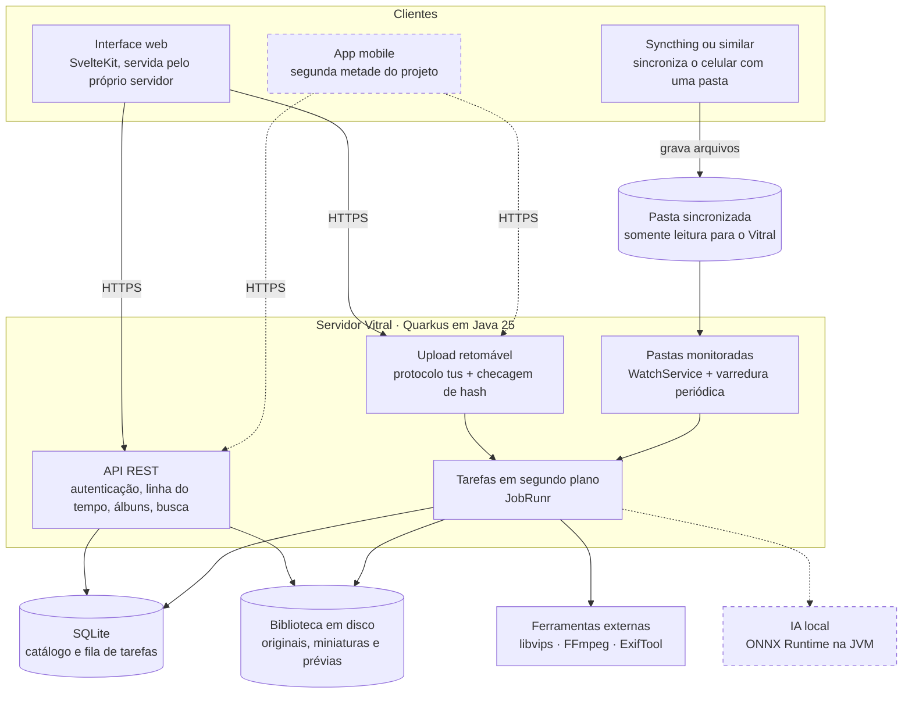
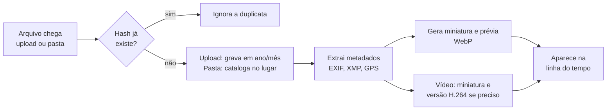

# Vitral · Servidor

Este é o servidor do [Vitral](../README.md). **Suas fotos, no seu servidor.** O Vitral é um gerenciador de fotos e vídeos self-hosted e totalmente open source: você instala em um servidor seu, envia suas fotos e navega por elas pelo navegador, sem entregar sua biblioteca a terceiros.

> **Status:** em desenvolvimento inicial (marco M0). Ainda não há versão utilizável.

## Princípios

- **Seus dados, seu servidor:** nenhuma chamada a serviços externos por padrão e nenhuma telemetria.
- **Originais intocáveis:** o Vitral nunca altera um arquivo original.
- **Leve primeiro:** roda sem GPU e em hardware modesto, como um PC antigo, um NAS ou um Raspberry Pi.
- **Formatos abertos:** os originais ficam em pastas comuns, legíveis sem o Vitral.

## Como o projeto está dividido

O Vitral é construído em duas metades:

1. **Servidor (foco atual):** armazena, cataloga e processa as fotos, e serve uma interface web para visualizá-las. É uma peça só: sobe o servidor, acessa o endereço, vê as fotos.
2. **App mobile (depois):** backup automático do celular e navegação no aparelho, usando a mesma API do servidor.

Enquanto o app não existe, o backup do celular pode ser feito com ferramentas de sincronização como o Syncthing, apontando para uma pasta que o Vitral monitora.

## Blueprint



Componentes tracejados são de fases futuras. Os clientes falam apenas com o servidor; banco, disco e ferramentas nunca ficam expostos à rede.

### Fluxo de ingestão

Todo arquivo, venha do upload ou de uma pasta monitorada, passa pela mesma sequência de tarefas. Cada etapa pode ser refeita sem reenviar o arquivo.



Arquivos de pastas monitoradas são catalogados no lugar: o Vitral só lê, nunca move nem apaga. Assim a sincronização com o celular continua funcionando normalmente.

### A impressão digital dos arquivos

O Vitral reconhece cada arquivo pelo seu SHA-256, um código de 64 caracteres calculado a partir do conteúdo. Ele funciona como uma impressão digital: depende só dos bytes do arquivo, e não do nome, da pasta ou da data. Por isso, o mesmo arquivo gera o mesmo código em qualquer lugar, seja no celular, no computador ou no servidor.

```bash
$ sha256sum IMG_1234.HEIC
9f86d081884c7d659a2feaa0c55ad015a3bf4f1b2b0b822cd15d6c15b0f00a08  IMG_1234.HEIC
```

Isso permite duas coisas:

- **Sem duplicatas:** ao receber um arquivo, o servidor calcula o código e, se o usuário já tem uma foto com o mesmo código, devolve a existente em vez de guardar uma cópia. Reenviar fotos, ou repetir um backup interrompido, nunca duplica nada.
- **Backup sem retransmitir:** um cliente calcula os códigos dos próprios arquivos, sem enviá-los, e pergunta ao `POST /api/v1/assets/check` quais o servidor ainda não tem. Num celular com 5.000 fotos em que 4.990 já foram salvas, só 10 arquivos trafegam.

O cliente nunca precisa receber os códigos do servidor: cada lado calcula os seus, e eles coincidem porque o conteúdo é o mesmo. O servidor também não confia no código informado pelo cliente; no upload, ele sempre recalcula a partir do que recebeu.

A contrapartida é que qualquer mudança nos bytes gera outro código. Uma foto editada, recortada ou convertida (por exemplo, de HEIC para JPEG ao ser exportada do celular) é um arquivo diferente para o Vitral, mesmo parecendo a mesma imagem. Reconhecer fotos *parecidas* é outro problema, previsto no roadmap como detecção de duplicatas e fotos parecidas.

## Stack

| Camada | Tecnologia |
| --- | --- |
| Linguagem | Java 25 (LTS) |
| Framework | Quarkus 3.33 LTS, em modo JVM (modo nativo como opção futura) |
| API | Quarkus REST (Jakarta REST) com documentação OpenAPI |
| Persistência | Hibernate ORM com Panache e migrações com Flyway |
| Banco de dados | SQLite em arquivo único, modo WAL |
| Senhas | Argon2id (Bouncy Castle), no formato PHC |
| Tarefas em segundo plano | JobRunr, com a fila guardada no próprio SQLite |
| Metadados | metadata-extractor, com ExifTool para casos difíceis |
| Imagens | libvips (com libheif para HEIC), chamado como processo externo |
| Vídeo | FFmpeg, chamado como processo externo |
| Interface web | SvelteKit, em [`vitral-frontend/`](../README.md) (planejado) |
| Build | Maven |
| Implantação | Docker Compose, imagens para amd64 e arm64 |

## Estrutura do repositório

```
vitral-backend/
├── server/                    # Servidor Quarkus (Maven)
│   └── src/main/java/com/genosha/vitral/
│       ├── common/            # Erros da API
│       ├── config/            # Configurações (prefixo vitral.)
│       ├── system/            # Informações públicas do servidor
│       ├── user/              # Usuários e administração
│       │   └── auth/          # Login, sessões e setup inicial
│       ├── asset/             # Itens: fotos, vídeos e o upload
│       ├── ingest/            # (M1) Upload tus, pastas monitoradas, importação
│       ├── media/             # Formatos, metadados e, no M1, miniaturas e vídeo
│       ├── storage/           # A biblioteca em disco
│       ├── timeline/          # (M2) Linha do tempo e busca
│       └── album/             # (M2) Álbuns e compartilhamento
├── docs/adr/                  # Registros de decisões de arquitetura
├── docker/                    # Dockerfile
├── docker-compose.yml
└── README.md
```

O código do servidor é organizado por funcionalidade, não por camada técnica: tudo o que diz respeito a álbuns, por exemplo, fica em `album/`. Pastas marcadas com (M1) ou (M2) chegam nesses marcos.

## Roadmap

**M0 · Fundação**
- [ ] Repositório, licença, CI e Docker Compose
- [x] Esqueleto do servidor Quarkus com SQLite e Flyway
- [x] Contas, login e sessões

**M1 · Ingestão**
- [x] Catálogo de fotos: upload, verificação de hashes, listagem, consulta e download do original
- [ ] Upload retomável com checagem de hash
- [ ] Pastas monitoradas e importação de pastas existentes
- [ ] Extração de metadados, miniaturas e prévias
- [ ] Processamento de vídeo

**M2 · Interface web (fecha a primeira metade)**
- [ ] Linha do tempo e visualizador
- [ ] Álbuns, favoritos, arquivo e lixeira
- [ ] Mapa e busca por metadados
- [ ] Compartilhamento por usuário e por link
- [ ] Importação do Google Takeout

**M3 · App mobile (segunda metade)**
- [ ] Backup automático em segundo plano
- [ ] Navegação na biblioteca pelo celular

**Depois**
- [ ] IA local: rostos, pessoas e busca semântica
- [ ] Duplicatas, memórias e edição básica não destrutiva
- [ ] Live Photos, RAW, armazenamento S3 e login via OIDC
- [ ] Exportação e importação do banco de dados pela API, restrita a administradores
- [ ] Pasta de dados padrão em `/var/lib/vitral` ao rodar fora do modo de desenvolvimento (o modo de desenvolvimento continua com `data/`)
- [ ] `VITRAL_LIBRARY_DIR` opcional, para guardar as fotos em outro disco, separadas do banco

## Requisitos para rodar (planejado)

- Java 25, ou Docker se preferir rodar em contêiner
- 2 núcleos de CPU e 4 GB de RAM
- Processador amd64 ou arm64

## Desenvolvimento

Pré-requisitos: JDK 25 e Maven 3.9 ou mais recente. Não é preciso Docker nem banco instalado.

```bash
cd server
mvn quarkus:dev
```

Os dados ficam em `server/data/`, criada na primeira execução: o banco SQLite (`vitral.db`), a biblioteca de fotos (`library/`) e os uploads em andamento (`tmp/`). As migrações são aplicadas automaticamente. A API fica em `http://localhost:8080` e a documentação interativa em `http://localhost:8080/q/swagger-ui`.

Para rodar os testes, use `mvn test`; eles usam um banco descartável em `target/`. Para gerar o Maven Wrapper (`./mvnw`), rode `mvn wrapper:wrapper` uma vez.

### Primeiros passos com a API

```bash
# Cria o administrador (só funciona enquanto o servidor não tem usuários)
curl -X POST http://localhost:8080/api/v1/setup \
  -H 'Content-Type: application/json' \
  -d '{"email":"voce@exemplo.com","displayName":"Você","password":"uma-senha-forte"}'

# Use o token retornado nas próximas chamadas
curl http://localhost:8080/api/v1/users/me -H 'Authorization: Bearer SEU_TOKEN'

# Envia uma foto (fileModifiedAt é opcional e serve de data quando a foto não tem EXIF)
curl -X POST http://localhost:8080/api/v1/assets \
  -H 'Authorization: Bearer SEU_TOKEN' \
  -F 'file=@IMG_1234.HEIC' \
  -F 'fileModifiedAt=2024-07-14T19:32:10Z'

# Pergunta quais fotos o servidor ainda não tem, antes de enviar
curl -X POST http://localhost:8080/api/v1/assets/check \
  -H 'Authorization: Bearer SEU_TOKEN' \
  -H 'Content-Type: application/json' \
  -d '{"hashes":["'"$(sha256sum IMG_1234.HEIC | cut -d' ' -f1)"'"]}'

# Lista as fotos, da mais recente para a mais antiga; para a página seguinte,
# repita com &cursor=<nextCursor da resposta>
curl 'http://localhost:8080/api/v1/assets?limit=20' -H 'Authorization: Bearer SEU_TOKEN'

# Mostra uma foto pelo id
curl http://localhost:8080/api/v1/assets/ID_DA_FOTO -H 'Authorization: Bearer SEU_TOKEN'

# Baixa o arquivo original, com o nome com que foi enviado
curl -OJ http://localhost:8080/api/v1/assets/ID_DA_FOTO/original -H 'Authorization: Bearer SEU_TOKEN'
```

### Configuração

| Variável de ambiente | Padrão | Para que serve |
| --- | --- | --- |
| `VITRAL_DATA_DIR` | `data` | Pasta com o banco, a biblioteca de fotos e os uploads temporários |
| `VITRAL_TIME_ZONE` | Fuso do sistema | Fuso usado para fotos sem fuso no EXIF e para as pastas de ano e mês |
| `VITRAL_UPLOAD_MAX_SIZE` | `4G` | Maior arquivo aceito por envio |

### Rodando sem Docker

```bash
cd server
mvn package
VITRAL_DATA_DIR=/caminho/para/dados java -jar target/quarkus-app/quarkus-run.jar
```

A pasta é criada se não existir. Sem a variável, os dados ficam em `data/` no diretório atual.

### Rodando com Docker Compose

```bash
docker compose up -d --build
```

O banco e as fotos ficam no volume `vitral-data`.

## Contribuindo

Contribuições são bem-vindas. As regras ficarão em `CONTRIBUTING.md`; os commits usam DCO (`git commit -s`) em vez de CLA. Decisões técnicas importantes são registradas em `docs/adr/`.

## Licença

[AGPL-3.0](../LICENSE) (proposta).