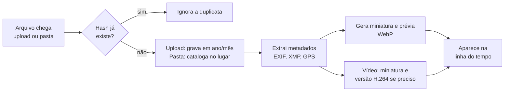

# Vitral

**Suas fotos, no seu servidor.** O Vitral é um gerenciador de fotos e vídeos self-hosted e totalmente open source: você instala em um servidor seu, envia suas fotos e navega por elas pelo navegador, sem entregar sua biblioteca a terceiros.

> **Status:** em desenvolvimento inicial (marco M0). Ainda não há versão utilizável.

## Princípios

- **Seus dados, seu servidor:** nenhuma chamada a serviços externos por padrão e nenhuma telemetria.
- **Originais intocáveis:** o Vitral nunca altera um arquivo original.
- **Leve primeiro:** roda sem GPU e em hardware modesto, como um PC antigo, um NAS ou um Raspberry Pi.
- **Formatos abertos:** os originais ficam em pastas comuns, legíveis sem o Vitral.

## Como o projeto está dividido

O Vitral é construído em duas metades:

1. **Servidor (foco atual):** armazena, cataloga e processa as fotos, e serve uma interface web para visualizá-las. É uma peça só: sobe o servidor, acessa o endereço, vê as fotos.
2. **App mobile (depois):** backup automático do celular e navegação no aparelho, usando a mesma API do servidor.

Enquanto o app não existe, o backup do celular pode ser feito com ferramentas de sincronização como o Syncthing, apontando para uma pasta que o Vitral monitora.

## Blueprint


Componentes tracejados são de fases futuras. Os clientes falam apenas com o servidor; banco, disco e ferramentas nunca ficam expostos à rede.

### Fluxo de ingestão

Todo arquivo, venha do upload ou de uma pasta monitorada, passa pela mesma sequência de tarefas. Cada etapa pode ser refeita sem reenviar o arquivo.



Arquivos de pastas monitoradas são catalogados no lugar: o Vitral só lê, nunca move nem apaga. Assim a sincronização com o celular continua funcionando normalmente.

## Stack

| Camada | Tecnologia |
| --- | --- |
| Linguagem | Java 25 (LTS) |
| Framework | Quarkus 3.33 LTS, em modo JVM (modo nativo como opção futura) |
| API | Quarkus REST (Jakarta REST) com documentação OpenAPI |
| Persistência | Hibernate ORM com Panache e migrações com Flyway |
| Banco de dados | PostgreSQL com pgvector |
| Senhas | Argon2id (Bouncy Castle), no formato PHC |
| Tarefas em segundo plano | JobRunr, com a fila guardada no próprio PostgreSQL |
| Metadados | metadata-extractor, com ExifTool para casos difíceis |
| Imagens | libvips (com libheif para HEIC), chamado como processo externo |
| Vídeo | FFmpeg, chamado como processo externo |
| Interface web | SvelteKit, compilada junto com o servidor via Quarkus Quinoa |
| Build | Maven |
| Implantação | Docker Compose, imagens para amd64 e arm64 |

## Estrutura do repositório

```
vitral/
├── server/                    # Servidor Quarkus (Maven)
│   └── src/main/java/dev/vitral/
│       ├── common/            # Erros da API
│       ├── config/            # Configurações (prefixo vitral.)
│       ├── system/            # Informações públicas do servidor
│       ├── user/              # Usuários e administração
│       │   └── auth/          # Login, sessões e setup inicial
│       ├── asset/             # (M1) Itens: fotos, vídeos e arquivos derivados
│       ├── ingest/            # (M1) Upload tus, pastas monitoradas, importação
│       ├── media/             # (M1) Metadados, miniaturas e vídeo
│       ├── storage/           # (M1) Acesso à biblioteca em disco
│       ├── timeline/          # (M2) Linha do tempo e busca
│       └── album/             # (M2) Álbuns e compartilhamento
├── web/                       # (M2) Interface web (SvelteKit)
├── docs/adr/                  # Registros de decisões de arquitetura
├── docker/                    # Dockerfile
├── docker-compose.yml
├── .env.example
└── README.md
```

O código do servidor é organizado por funcionalidade, não por camada técnica: tudo o que diz respeito a álbuns, por exemplo, fica em `album/`. Pastas marcadas com (M1) ou (M2) chegam nesses marcos.

## Roadmap

**M0 · Fundação**
- [ ] Repositório, licença, CI e Docker Compose
- [ ] Esqueleto do servidor Quarkus com PostgreSQL e Flyway
- [ ] Contas, login e sessões

**M1 · Ingestão**
- [ ] Upload retomável com checagem de hash
- [ ] Pastas monitoradas e importação de pastas existentes
- [ ] Extração de metadados, miniaturas e prévias
- [ ] Processamento de vídeo

**M2 · Interface web (fecha a primeira metade)**
- [ ] Linha do tempo e visualizador
- [ ] Álbuns, favoritos, arquivo e lixeira
- [ ] Mapa e busca por metadados
- [ ] Compartilhamento por usuário e por link
- [ ] Importação do Google Takeout

**M3 · App mobile (segunda metade)**
- [ ] Backup automático em segundo plano
- [ ] Navegação na biblioteca pelo celular

**Depois**
- [ ] IA local: rostos, pessoas e busca semântica
- [ ] Duplicatas, memórias e edição básica não destrutiva
- [ ] Live Photos, RAW, armazenamento S3 e login via OIDC

## Requisitos para rodar (planejado)

- Docker e Docker Compose
- 2 núcleos de CPU e 4 GB de RAM
- Processador amd64 ou arm64

## Desenvolvimento

Pré-requisitos: JDK 25, Maven 3.9 ou mais recente e Docker.

```bash
cd server
mvn quarkus:dev
```

Com o Docker rodando, o Quarkus sobe sozinho um PostgreSQL de desenvolvimento (Dev Services) e aplica as migrações. A API fica em `http://localhost:8080` e a documentação interativa em `http://localhost:8080/q/swagger-ui`.

Para rodar os testes, use `mvn test` (o teste de ponta a ponta também usa o Docker). Para gerar o Maven Wrapper (`./mvnw`), rode `mvn wrapper:wrapper` uma vez.

### Primeiros passos com a API

```bash
# Cria o administrador (só funciona enquanto o servidor não tem usuários)
curl -X POST http://localhost:8080/api/v1/setup \
  -H 'Content-Type: application/json' \
  -d '{"email":"voce@exemplo.com","displayName":"Você","password":"uma-senha-forte"}'

# Use o token retornado nas próximas chamadas
curl http://localhost:8080/api/v1/users/me -H 'Authorization: Bearer SEU_TOKEN'
```

### Rodando com Docker Compose

```bash
cp .env.example .env     # troque a senha do banco no .env
docker compose up -d --build
```

## Contribuindo

Contribuições são bem-vindas. As regras ficarão em `CONTRIBUTING.md`; os commits usam DCO (`git commit -s`) em vez de CLA. Decisões técnicas importantes são registradas em `docs/adr/`.

## Licença

[AGPL-3.0](LICENSE) (proposta).
